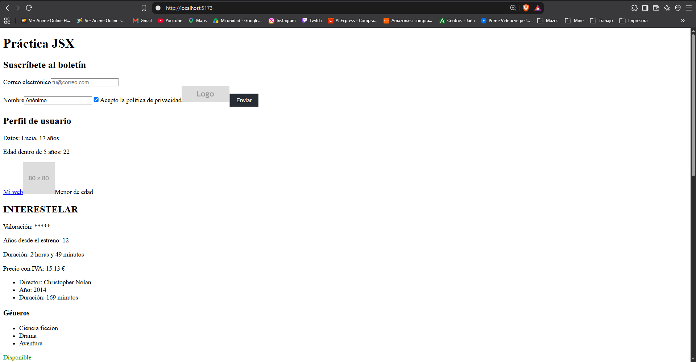

# React + Vite

This template provides a minimal setup to get React working in Vite with HMR and some ESLint rules.

Currently, two official plugins are available:

- [@vitejs/plugin-react](https://github.com/vitejs/vite-plugin-react/blob/main/packages/plugin-react) uses [Oxc](https://oxc.rs)
- [@vitejs/plugin-react-swc](https://github.com/vitejs/vite-plugin-react/blob/main/packages/plugin-react-swc) uses [SWC](https://swc.rs/)

## React Compiler

The React Compiler is not enabled on this template because of its impact on dev & build performances. To add it, see [this documentation](https://react.dev/learn/react-compiler/installation).

## Expanding the ESLint configuration

If you are developing a production application, we recommend using TypeScript with type-aware lint rules enabled. Check out the [TS template](https://github.com/vitejs/vite/tree/main/packages/create-vite/template-react-ts) for information on how to integrate TypeScript and [`typescript-eslint`](https://typescript-eslint.io) in your project.

En esta práctica he trabajado con JSX en React. He aprendido a transformar código HTML a JSX, crear componentes y utilizar expresiones JavaScript para mostrar información de forma dinámica.

También he corregido varios errores habituales al trabajar con JSX y he terminado creando una pequeña aplicación que reúne todos los ejercicios.

He creado un formulario a partir de un código HTML y lo he adaptado a la sintaxis de JSX. También he añadido un botón que muestra un mensaje cuando lo pulso.

Tambien he corregido errores de un archivo proporcionado, se han econtrado los siguientes:

El nombre del componente empezaba por minúscula: lo he cambiado para que empiece por mayúscula, como se hace con los componentes de React.

Había varios elementos sin agrupar: he utilizado un fragmento para poder mostrar todos los elementos juntos.

Se utilizaba class en vez de className: he cambiado la palabra para que React pueda reconocer correctamente las clases.

Los comentarios estaban escritos como en HTML: los he cambiado a la forma que se utiliza en JSX.

Se intentaba mostrar todos los datos del usuario a la vez: he indicado qué dato quería mostrar, como su nombre o su edad.

La suma de la edad estaba mal escrita: he cambiado el "5" por un 5 para que se sume como un número.

El enlace tenía la dirección mal indicada: he corregido la forma de escribir la variable para que el enlace funcione correctamente.

La imagen no estaba cerrada correctamente: he añadido el cierre que necesita la etiqueta.

La condición para saber si era mayor de edad estaba mal escrita: la he cambiado para que muestre un mensaje u otro dependiendo de la edad del usuario.

